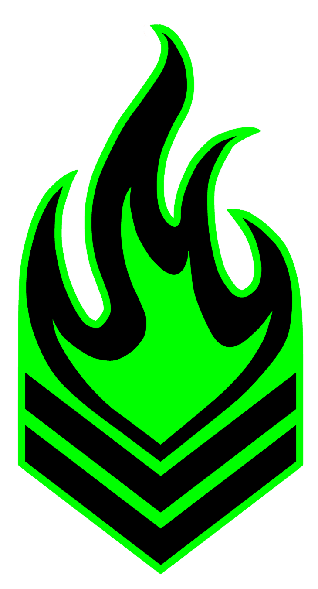
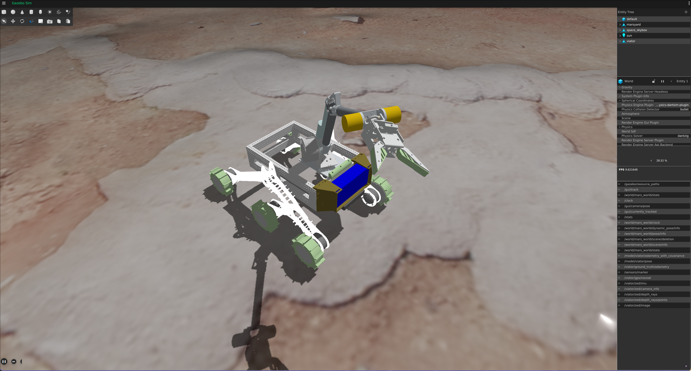
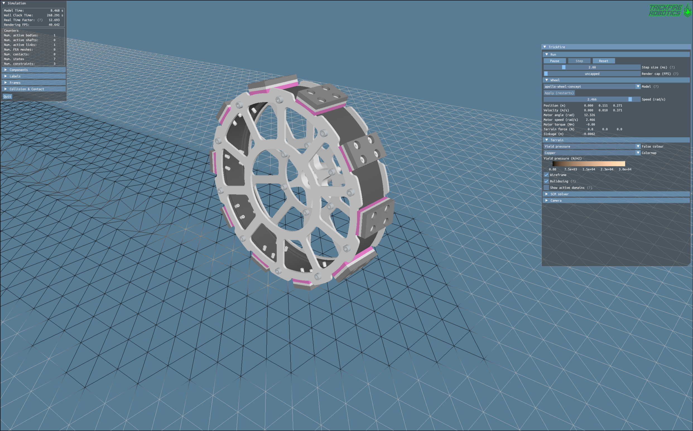

# Simulations

Rover simulation environments for TrickFire Robotics.

Two complementary environments, both driven by a single Python `sim` CLI: [**Gazebo Harmonic**](https://gazebosim.org/docs/harmonic/install/) with [ROS 2 Jazzy](https://docs.ros.org/en/jazzy/index.html) for simulating robot subsystems and joint control, and [**Project Chrono**](https://projectchrono.org/) for high-fidelity terrain and wheel-soil physics. The whole project is containerized in a Docker environment with user environment passthrough or using with [pixi](https://pixi.prefix.dev/latest/).

## Highlights
k
- **Viator** - our rover and its arm, generated directly from [OnShape](https://www.onshape.com/) CAD via `sim gazebo create`
- **Marsyard terrain** - a heightmap of the European Rover Challenge terrain, for realistic Mars-like drive and arm testing
- **Deformable terrain** - wheel-soil interaction in Chrono via the [SCM model](https://api.projectchrono.org/manual_SCM.html)
- **Drone** - simulated through [ArduPilot](https://ardupilot.org/)

## Documentation

**Full documentation is at [docs.trickfirerobotics.com/simulations](https://docs.trickfirerobotics.com/simulations)**

- [Getting Started](https://docs.trickfirerobotics.com/simulations) - native setup, Dev Container alternative, first launch
- [Running Gazebo](https://docs.trickfirerobotics.com/simulations/gazebo/gazebo) - `sim gazebo` CLI usage and flags
- [Running Chrono](https://docs.trickfirerobotics.com/simulations/chrono/chrono) - `sim chrono` CLI usage
- [Adding a New Robot](https://docs.trickfirerobotics.com/simulations/gazebo/adding-robots) - OnShape to Gazebo with `sim gazebo create`
- [Dev Notes](https://docs.trickfirerobotics.com/simulations/dev-notes) - architecture decisions, Docker environment internals, CLI tips

## Credits

Some simulation assets are vendored from outside sources:

- **Marsyard terrain** - from [Mars Society Polska](https://marssociety.pl/), vendored via [LeoRover/leo_simulator-ros2](https://github.com/LeoRover/leo_simulator-ros2) under the MIT license
- **Walking person model** - by Marina Kollmitz, created with [MakeHuman](http://www.makehuman.org/)
- **Hammer model** - by Nate Koenig / Open Source Robotics Foundation
- **Space skybox starfield** - built from NASA/Goddard Space Flight Center's [Deep Star Maps 2020](https://svs.gsfc.nasa.gov/4851/) (Gaia DR2 data: ESA/Gaia/DPAC)

See each model's directory under `gazebo/sim_worlds/models/` for full attribution and license details. Thank you to each one of these sources for providing these assets!
